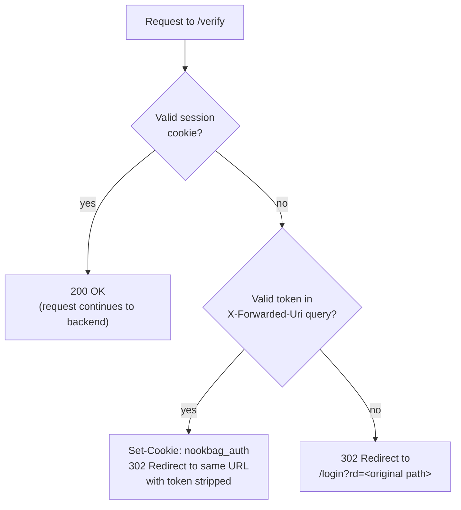
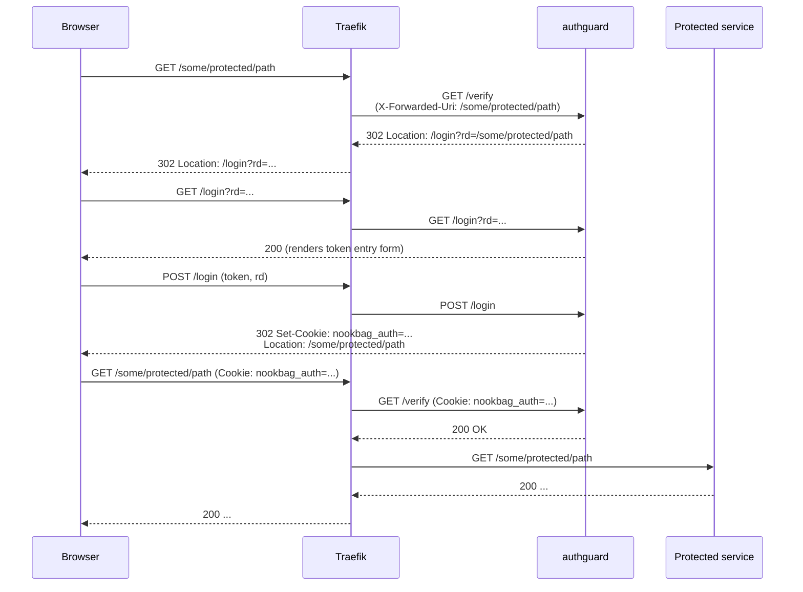

# authguard

A tiny, dependency-free [ForwardAuth](https://doc.traefik.io/traefik/middlewares/http/forwardauth/) service for Traefik.

It gives every route behind the proxy a single shared "deploy-time" access token. The
first visitor exchanges that token for a signed, expiring cookie, so the browser
doesn't need to keep passing the token on every subsequent request.

There is no database, no user accounts, and no session store — just an
HMAC-signed cookie value checked on every request. It's meant for short-lived
demo/lab environments (e.g. behind a Traefik instance) where "one shared
token per deployment" is enough, not for multi-user auth.

## How it works

Traefik's `forwardAuth` middleware sends every incoming request to authguard's
`/verify` endpoint before it reaches the real backend. authguard answers `200`
(let it through) or `302` (send the browser to the login page) based on
whether the request carries a valid session cookie or a valid token.



(GET/HEAD only - a token-in-URL request using another method gets an
immediate `200` instead, since a `302` would otherwise turn it into a `GET`
on redirect.)

Full round trip for a browser that doesn't have a cookie yet:



A visitor can also skip the login form by appending `?token=<AUTH_TOKEN>`
directly to a protected URL — Traefik forwards the original query string via
the `X-Forwarded-Uri` header, authguard reads the token from it, sets the
cookie, and (for GET/HEAD requests) redirects back to the same URL with
`token` stripped out, so it doesn't linger in the browser's address bar,
history, or a `Referer` header.

## Routes

| Method | Path     | Purpose                                                                 |
|--------|----------|--------------------------------------------------------------------------|
| GET    | `/verify`| Called internally by Traefik's `forwardAuth` middleware on every request |
| GET    | `/login` | Renders the token entry form                                             |
| POST   | `/login` | Validates the submitted token, sets the cookie, redirects to `rd`        |

## Configuration

All configuration is via environment variables:

| Variable              | Required | Default | Description                                              |
|-----------------------|----------|---------|------------------------------------------------------------|
| `AUTH_TOKEN`           | yes      | —       | Shared secret token users enter (or pass as `?token=`)    |
| `SESSION_SECRET`       | yes      | —       | HMAC key used to sign the session cookie                 |
| `SESSION_TTL_SECONDS`  | no       | `43200` (12h) | How long the session cookie stays valid             |
| `PORT`                 | no       | `8080`  | Port the HTTP server listens on                           |
| `RATE_LIMIT_MAX_ATTEMPTS` | no    | `10`    | Failed token attempts (per client, per window) before lockout |
| `RATE_LIMIT_WINDOW_SECONDS` | no  | `60`    | Sliding window used to count failed attempts              |
| `RATE_LIMIT_LOCKOUT_SECONDS` | no | `300`   | How long a client is locked out after crossing the limit  |

The process refuses to start if `AUTH_TOKEN` or `SESSION_SECRET` is unset.

## Running

### Locally (Node.js)

```bash
AUTH_TOKEN=change-me SESSION_SECRET=change-me-too node server.js
```

### Tests

```bash
node --test
```

Uses Node's built-in test runner against `test/server.test.js` - no npm
dependencies, consistent with the rest of this service.

### As a container

```bash
podman build -t authguard .
podman run -p 8080:8080 \
  -e AUTH_TOKEN=change-me \
  -e SESSION_SECRET=change-me-too \
  authguard
```

## Deploying behind Traefik

`authguard` is deployment-target-agnostic, but the `trustForwardHeader`
setting on the Traefik `forwardAuth` middleware in front of it is **not**
— it must match how *that* Traefik terminates TLS:

- **VM / podman-compose** (Traefik terminates real TLS itself, is the
  network edge): use `trustForwardHeader: false`. Traefik will correctly
  self-compute `X-Forwarded-Proto`/`X-Forwarded-Uri` from the real
  connection it holds; no client header needs to be (or should be) trusted.
- **OpenShift single-pod chart** (Traefik only ever listens on plain HTTP
  inside the Pod; the OpenShift Router terminates TLS one hop upstream and
  overwrites `X-Forwarded-Proto`/`Host`/`Port` by default before forwarding):
  use `trustForwardHeader: true`. Without it, Traefik would always see
  "http" locally (no TLS listener of its own) and the session cookie would
  never get the `Secure` flag.

Using the wrong value per environment either breaks the `Secure` cookie
flag (OCP without `true`) or lets a client spoof it (VM with `true` instead
of `false`). See `rhpds/showroom` (`vm_workload_showroom`) and
`rhpds/showroom-deployer` (`showroom-single-pod` chart) for the reference
wiring of each.

Register authguard as a `forwardAuth` middleware and attach it to any router
you want to protect:

```yaml
http:
  middlewares:
    authguard:
      forwardAuth:
        address: "http://authguard:8080/verify"
        trustForwardHeader: true  # see "Deploying behind Traefik" above
        preserveLocationHeader: true
        addAuthCookiesToResponse:
          - nookbag_auth

  routers:
    login:
      rule: "PathPrefix(`/login`)"
      service: authguard-svc
      priority: 10

    protected:
      rule: "PathPrefix(`/some/app`)"
      service: some-app
      middlewares:
        - authguard

  services:
    authguard-svc:
      loadBalancer:
        servers:
          - url: "http://authguard:8080"
```

Notes:

- The `/login` router must be registered **without** the `authguard`
  middleware (and typically at a higher `priority`) so the login page itself
  is reachable.
- `addAuthCookiesToResponse: [nookbag_auth]` tells Traefik to copy the
  `Set-Cookie` header from authguard's `/verify` response onto the response
  Traefik sends to the browser.

## Security notes

- Cookie value is `<expiryMs>.<hmac-sha256(expiryMs)>` — stateless, no
  server-side session store, nothing to leak beyond the one secret.
- Token and MAC comparisons use `crypto.timingSafeEqual` (with a
  length-blinding trick) to avoid trivial timing side channels.
- The `rd` (redirect) query parameter is restricted to same-origin, relative
  paths to prevent the login flow from being turned into an open redirect.
- The cookie is `HttpOnly`, `SameSite=Lax`, and gets the `Secure` flag
  automatically whenever the request arrived over `https` (via
  `X-Forwarded-Proto`) — see "Deploying behind Traefik" above for why the
  correct `trustForwardHeader` value depends on the deployment target.
- Rotate `AUTH_TOKEN` and `SESSION_SECRET` before sharing an environment —
  the defaults used in local dev are not safe for anything shared or public.
- A token-in-URL login (`?token=...`) on a GET/HEAD request is immediately
  redirected to the same URL with `token` removed, so the secret doesn't
  persist in browser history or get leaked via `Referer` on later
  navigation. It's still visible in the one access log line for that first
  request — rotate `AUTH_TOKEN` if a URL containing it was ever shared or
  logged somewhere untrusted.
- Failed token attempts (on `/verify?token=` and `POST /login`) are
  rate-limited per client (`RATE_LIMIT_MAX_ATTEMPTS` within
  `RATE_LIMIT_WINDOW_SECONDS`, then locked out for
  `RATE_LIMIT_LOCKOUT_SECONDS`). This is an in-memory, per-process limit —
  it resets on restart and isn't shared across replicas — so it raises the
  cost of brute-forcing `AUTH_TOKEN` but doesn't replace using a long,
  random one.
